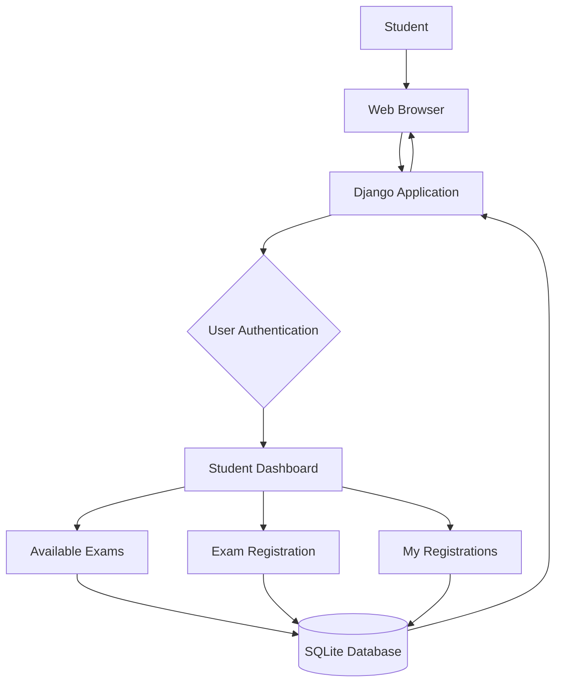
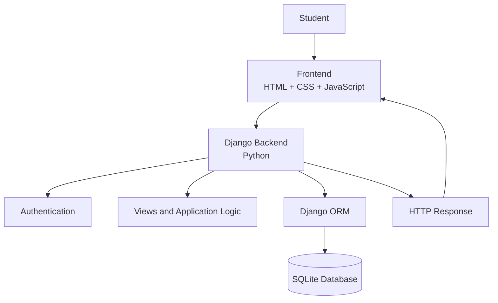

# Exam Registration System


A web-based examination registration platform developed using Python and Django. The application provides students with a convenient way to access examination information, view available exams and manage their examination registrations through a centralized online system.

**Live Demo:** https://swethakannan.pythonanywhere.com

**GitHub Repository:** https://github.com/swethakannan595-crypto/exam-registration-system

---

## Overview

Managing examination registrations manually can be time-consuming and difficult to organize. Students may face challenges accessing examination details and tracking their registration information.

The Exam Registration System provides an online platform to simplify this process. Students can log in, access their dashboard, explore available examinations and view their registrations.

The application is developed using the Django framework and uses SQLite for database management. It is deployed on PythonAnywhere and can be accessed through a web browser.

## Key Features

- **User Authentication:** Provides a login system for accessing the application.
- **Student Dashboard:** Offers a centralized interface for navigating the application.
- **Available Exams:** Displays the available examination information.
- **Exam Registration:** Provides functionality for students to register for examinations.
- **My Registrations:** Allows students to view their registration details.
- **Database Management:** Uses SQLite to store and manage application data.
- **Responsive Web Interface:** Provides a browser-based interface for accessing the system.
- **Cloud Deployment:** Hosted on PythonAnywhere for online accessibility.

## Main Modules

| Module | Description |
|---|---|
| Login | Allows users to access the application |
| Dashboard | Provides the main navigation interface |
| Available Exams | Displays examination information |
| Exam Registration | Handles examination registration |
| My Registrations | Displays existing registration details |

## How It Works



1. The student opens the application through a web browser.
2. The user logs in to access the application.
3. Django processes the login request and displays the dashboard.
4. The student views available examinations.
5. The student proceeds with examination registration.
6. Registration information is stored in the SQLite database.
7. The student can view their registration details through the My Registrations section.

## Architecture



The application follows the Django Model-View-Template (MVT) architecture. The frontend communicates with Django, which handles application logic and database operations.

## Tech Stack

| Layer | Technology |
|---|---|
| Programming Language | Python |
| Backend Framework | Django |
| Frontend | HTML, CSS, JavaScript |
| Database | SQLite |
| Database Interaction | Django ORM |
| Development Environment | Visual Studio Code |
| Version Control | Git and GitHub |
| Deployment Platform | PythonAnywhere |

## Project Structure

```text
exam-registration-system/
│
├── exams/
│   ├── migrations/
│   ├── templates/
│   ├── static/
│   ├── models.py
│   ├── views.py
│   ├── urls.py
│   └── ...
│
├── examsite/
│   ├── settings.py
│   ├── urls.py
│   ├── wsgi.py
│   └── asgi.py
│
├── static/
├── db.sqlite3
├── manage.py
├── requirements.txt
├── build.sh
├── README.md
└── LICENSE
```

*Note: The structure above shows the main project components. Individual files and folders may vary according to the repository.*

## Getting Started

### Prerequisites

- Python 3.10 or later
- pip (Python package manager)
- Git
- Visual Studio Code or another code editor
- A web browser

### 1. Clone the Repository

```bash
git clone https://github.com/swethakannan595-crypto/exam-registration-system.git

cd exam-registration-system
```

### 2. Create a Virtual Environment

**Windows:**

```bash
python -m venv venv
venv\Scripts\activate
```

**macOS / Linux:**

```bash
python3 -m venv venv
source venv/bin/activate
```

### 3. Install Dependencies

```bash
pip install -r requirements.txt
```

### 4. Apply Database Migrations

```bash
python manage.py migrate
```

### 5. Run the Development Server

```bash
python manage.py runserver
```

Open the application in your browser:

```text
http://127.0.0.1:8000/
```

## Deployment

The application is deployed using **PythonAnywhere**, a cloud hosting platform for Python web applications.

| Component | Platform | Purpose |
|---|---|---|
| Source Code | GitHub | Repository and version control |
| Backend | Django | Application processing |
| Database | SQLite | Data storage |
| Hosting | PythonAnywhere | Online application deployment |

### Deployment Process

1. Created a PythonAnywhere account.
2. Cloned the GitHub repository into the PythonAnywhere environment.
3. Created and configured a Python virtual environment.
4. Installed the required Python packages.
5. Configured the Django WSGI application.
6. Configured the allowed host and static files.
7. Collected static files using Django.
8. Reloaded and tested the deployed web application.

**Live Application:** https://swethakannan.pythonanywhere.com

## Testing

The application can be tested using the following test cases:

| Test Case | Expected Result |
|---|---|
| Open application URL | Application should load |
| Login with valid credentials | Dashboard should open |
| Access Available Exams | Examination details should display |
| Open registration section | Registration interface should open |
| Access My Registrations | Registration details should display |
| Refresh application | Application should remain accessible |

## Future Enhancements

- Online examination fee payment integration.
- Automatic hall-ticket generation.
- Email notifications for registration confirmation.
- Student profile management.
- Examination timetable management.
- Admin dashboard for managing examinations.
- Downloadable registration confirmation.
- Examination results management.

## Learning Outcomes

Through this project, I gained practical experience in:

- Python programming and Django web development.
- Developing web applications using the MVT architecture.
- Database operations using SQLite and Django ORM.
- Implementing user authentication.
- Building frontend interfaces using HTML and CSS.
- Managing source code using Git and GitHub.
- Deploying a Django application on a cloud hosting platform.

## Username & Password

-username: admin    password: admin123
-username: student  password: student123

## Author

**Swetha Kannan**

B.Sc. Information Technology  
Sri Ramakrishna College of Arts & Science for Women, Coimbatore.

- **GitHub:** [swethakannan595-crypto](https://github.com/swethakannan595-crypto)
- **Project Repository:** [Exam Registration System](https://github.com/swethakannan595-crypto/exam-registration-system)
- **Live Demo:** [Exam Registration System](https://swethakannan.pythonanywhere.com)

## License

This project is distributed under the license included in the repository. Refer to the [LICENSE](LICENSE) file for details.
